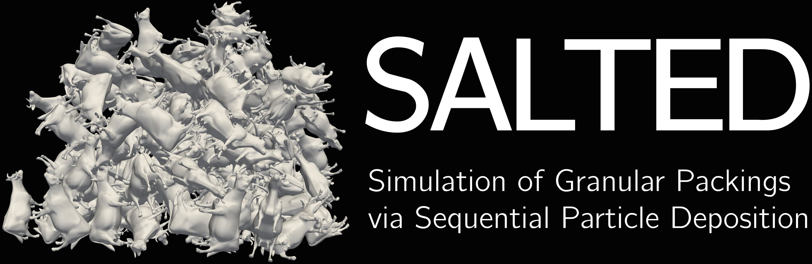
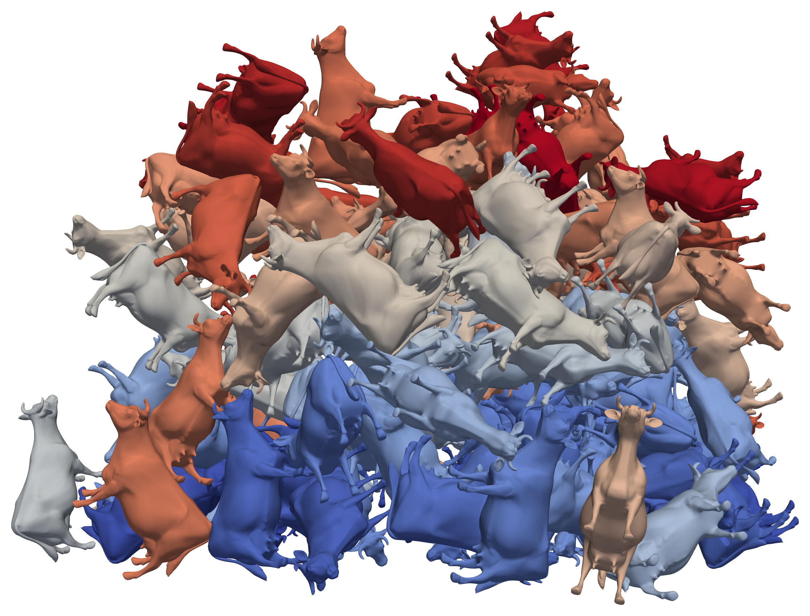

<div align="center">
  
  <p><strong>Generate and explore 3D packings of complex-shaped particles.</strong></p>
</div>

## What is SALTED?

SALTED creates static particle packings by depositing rigid particles one at a
time. Choose the particle geometry, particle count, simulation dimensions and
random seed. SALTED calculates the deposited arrangement and exports it for
inspection in ParaView or analysis with other tools.

Custom shapes can be defined as set of (overlapping) spheres or generated from STL meshes
using the included [GEMSS](https://github.com/aqa-arash/GEMSS) library [2,3]. A command-line program runs the simulations;
an optional Python interface supports repeated runs and parameter studies.

<p align="center">
  
</p>

*Example: a packing of 150 cow-shaped particles, displayed using their original STL surfaces.*

## Key features

- **Use custom particle shapes.** Load multisphere particles or generate them from binary STL meshes with GEMSS.
- **Control deposition.** Set particle dimensions, particle count, simulation size and random seed in a configuration file.
- **Inspect the packing.** Export the multisphere particles or display the deposited particles using their original STL surfaces.
- **Automate studies.** Reuse multisphere particles and vary simulation settings through the executable or Python.

## Quick start

### Build SALTED

Requirements: Linux with glibc, a C++20 compiler, CMake ≥3.20 and the GNU
Scientific Library (GSL) ≥2.0. On Ubuntu or Debian:

```bash
sudo apt install build-essential cmake libgsl-dev
```

From the SALTED folder containing `CMakeLists.txt`:

```bash
cmake -S . -B build -DCMAKE_BUILD_TYPE=Release
cmake --build build --parallel 2
```

To also generate particles from STL, install Eigen ≥3.4 (`sudo apt install
libeigen3-dev` on Ubuntu or Debian). Use this configuration command in place of
the first CMake command above, then compile with the same build command:

```bash
cmake -S . -B build -DCMAKE_BUILD_TYPE=Release -DSDBD_ENABLE_GEMSS=ON
```

The executable is `build/deposit`. Compile once and reuse it for different runs.
All commands and Python examples below assume the SALTED folder as the current directory.

### Run an example

The included cube example deposits 12 particles:

```bash
build/deposit run examples/cube/config.conf
```

Its configuration selects `results/cube/` as the output folder. This contains
`deposition.vtk`, describing the final sphere geometry, and `run.conf`, recording
the simulation settings and completed run. Open the VTK file in ParaView and use
sphere glyphs to display the packing; see the [visualization guide](docs/exports.md).

SALTED protects previous results by refusing to overwrite an existing output
folder. Choose another folder to repeat the example:

```bash
build/deposit run examples/cube/config.conf --output results/cube-second-run
```

## Configure your own simulation

Settings use plain-text `key = value` files. For example, save this as
`simulation.conf` in the SALTED folder:

```ini
particle = cube
size = 180
resolution = 3
count = 12
box = 1440 1440 1440
units = mm
seed = 84328
rng = mt19937
output = results/my-simulation
```

| Setting | Meaning |
|---|---|
| `particle` | Built-in shape name or path to a custom particle file. |
| `size`, `resolution` | Dimensions and sphere discretization of built-in shapes. Here, a nominal 180 mm cube uses 26 surface spheres. |
| `count` | Number of complete particles to deposit. |
| `box`, `units` | Horizontal x/y lengths and maximum packing height, in the declared length unit. |
| `seed`, `rng` | Random seed and generator; reuse both for reproducible runs with the same settings. |
| `output` | Folder for simulation results. |

Check the inputs, then run:

```bash
build/deposit validate --config simulation.conf
build/deposit run simulation.conf
```

The floor is at z = 0. Horizontal boundaries are periodic and the top is open;
a run fails if a deposited particle exceeds the specified height. Paths inside
configuration files are relative to those files. See the
[configuration reference](docs/configuration.md) for advanced controls.

## Use your own particle geometry

A multisphere particle is a rigid group of spheres, which may overlap internally.
Supply sphere centers, radii and a physical center of mass using the
[particle file format](docs/particles.md), then select that file with `particle`.

For STL input, enable GEMSS during compilation as described above. The included
[rock generation configuration](examples/rock/generation.conf) selects the mesh
and reconstruction settings. Its main fields are:

```ini
stl = example_mesh.stl
units = mm
maximum_spheres = 50
accuracy = 0.9
```

To use another mesh, copy that configuration and change `stl` and `units` to match
your model. Sphere count and reconstruction accuracy control the approximation;
the remaining generation settings are documented in the configuration reference.

Generate the included rock with:

```bash
build/deposit generate examples/rock/generation.conf
```

This writes `results/rock-regenerated.particle`. Reuse it by saving the following
as `rock-study.conf` in the SALTED folder:

```ini
particle = results/rock-regenerated.particle
count = 24
box = 60 60 60
units = mm
seed = 84328
rng = mt19937
output = results/rock-study
```

```bash
build/deposit run rock-study.conf
```

GEMSS calculates physical volume, center of mass and inertia from the original
STL target geometry. These properties remain separate from the spheres used for
contact calculations; overlapping sphere volumes are not summed to define mass.
The calculation assumes uniform density and approximates the target on a voxel grid.

## Python interface (optional)

After building SALTED, install the wrapper with Python ≥3.10:

```bash
python3 -m pip install ./python
```

```python
from salted_deposition import Simulator

sim = Simulator("build/deposit")
result = sim.run("examples/cube/config.conf", output="results/python-cube",
                 count=4, seed=12345)
print(result.vtk_path)
```

`run()` accepts a configuration and optional overrides for common settings.
With GEMSS enabled, `generate_particle()` creates reusable particles from STL.
All geometry processing and numerical calculations remain in C++. See the
[Python API reference](docs/configuration.md#python-api) for arguments and path behavior.

## Results and visualization

| File | Contents and use |
|---|---|
| `deposition.vtk` | Final sphere centers, radii and particle identifiers. Display these spheres to inspect the geometry used for contact calculations. Written for every run. |
| `stl_poses.vtk` | Mesh placement points, orientation quaternions and scale factors. Combine with the unchanged original STL to display the deposited particle surfaces. Written when the particle retains its STL reference and coordinate frame. |
| `run.conf` | Simulation settings, random seed, software version, completion status and final particle centers of mass. Use it to document or repeat the calculation. |

The STL pose points locate the transformed mesh origins; physical centers of mass
are recorded separately in `run.conf`. The original STL is reused for all particles,
without storing a mesh copy for each one. Color the packing by `particle_id` to
distinguish particles. The [export guide](docs/exports.md) contains details on the export formats.

The sphere view shows the collision geometry. The STL view shows the original
surfaces, which may differ where the sphere approximation fails to capture shape features.

## Deposition method and limitations

SALTED implements steepest-descent ballistic deposition [1]. Each particle falls
under gravity and rotates around its supports along the allowed path of steepest
decrease in gravitational potential energy. The calculation advances directly to
the next contact or stopping event. Once settled, a particle
remains fixed while the next one is deposited.

The model neglects inertia, bouncing and rearrangement of deposited particles.
Each run repeats one particle shape. Horizontal box lengths must be positive
integers in the declared unit. Sphere approximations can omit fine mesh features;
some shapes or seeds can stall during settling, and redropping does not guarantee completion.

## Included examples

- [Cube](examples/cube/README.md): the original surface-sphere representation for comparison with the original implementation.
- [Stick](examples/stick/README.md): an elongated particle built from overlapping spheres.
- [Rock](examples/rock/README.md): an STL mesh and its already generated 19-sphere particle definition; run it without repeating geometry generation.

## Authors, references and license

Original implementation: **Nikola Topic**. Deposition methodology: **Nikola Topic
and Thorsten Pöschel**. Modernized implementation: **Felix Buchele**. Original
vector routines: **Thomas Schwager**. GEMSS generation: **Arash Moradian,
Felix Buchele, Patric Müller, Thorsten Pöschel**, and contributors.

1. N. Topic and T. Pöschel. *Steepest descent ballistic deposition of complex shaped particles*. Journal of Computational Physics **308**, 421–437 (2016). [DOI](https://doi.org/10.1016/j.jcp.2015.12.052).
2. A. Moradian, F. Buchele, P. Müller and T. Pöschel. *GEMSS: A C++ library for multi-sphere modeling in DEM simulations*. Powder Technology **486**, 123162 (2027). [DOI](https://doi.org/10.1016/j.powtec.2026.123162).
3. F. Buchele, T. Pöschel and P. Müller. *Multi-sphere shape generator for DEM simulations of complex-shaped particles*. Powder Technology **480**, 122635 (2026). [DOI](https://doi.org/10.1016/j.powtec.2026.122635).

SALTED source and the included rock geometry are distributed under [MIT](LICENSE).
Dependencies retain their own terms; GSL-linked executables require GPL compliance.
See [third-party licenses](docs/licenses.md).

The illustration uses *cow2* by Viewpoint Animation Engineering, Sun Microsystems,
from the [Princeton Suggestive Contour Gallery](https://gfx.cs.princeton.edu/proj/sugcon/models/).
The cow mesh is not distributed with SALTED and retains its creators' rights.
